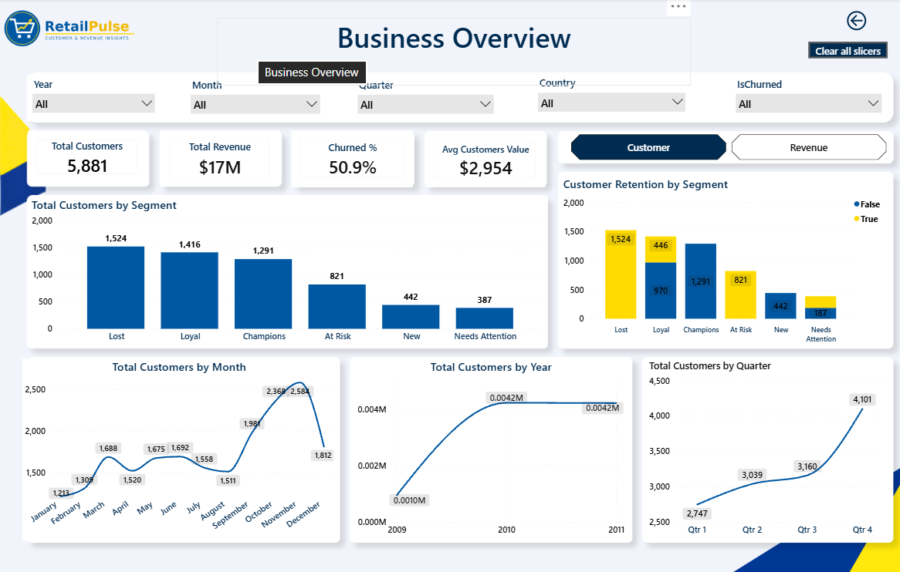

# Customer Insights from Online Retail Data

## Table of Contents
- [Overview](#overview)
- [Problem Statement](#problem-statement)
- [Dataset](#dataset)
- [Tools and Technologies](#tools-and-technologies)
- [Methods](#methods)
- [Key Insights](#key-insights)
- [Dashboard / Model / Output](#dashboard--model--output)
- [How to Run This Project?](#how-to-run-this-project)
- [Results & Conclusion](#results--conclusion)
- [Author](#author)

--- 
Analysed over 1 million online retail transactions using SQL, Python and RFM analysis to identify valuable customers, understand purchasing behaviour and detect customers at risk of churn through an interactive Power BI dashboard.

## Overview

This project focuses on understanding customer purchasing behaviour and identifying valuable customers for an online retail business.

Two online retail datasets covering 2009–2010 and 2010–2011 were cleaned and combined using SQL. Python and Pandas were used to filter transaction data, calculate RFM metrics, assign customer scores and create customer segments. The final dataset was exported in Excel format using Pandas and imported into Power BI to build an interactive dashboard.

## Problem Statement

An online retail business needs to understand its customers to identify valuable customers, monitor purchasing behaviour and recognise customers who may stop purchasing.

This project aims to answer the following questions:

- How recently, frequently and how much do customers purchase?
- Which customers are the most valuable to the business?
- Which customers are loyal, new or at risk?
- Which customers have not made a purchase in more than 90 days?
- How can customer behaviour and revenue be explored through an interactive dashboard?

## Dataset

The project uses two online retail datasets:

| Dataset | Period |
|---|---|
| Online Retail Data | 2009–2010 |
| Online Retail Data | 2010–2011 |

Both datasets were imported into SQL, cleaned and combined into a single dataset containing approximately 1.03 million records.

**Output:** `RetailCleaned.csv`

## Tools and Technologies

| Tool | Purpose |
|---|---|
| SQL | Importing, cleaning and combining datasets |
| Python | Data analysis |
| Pandas | Data filtering, RFM calculation, scoring and customer segmentation |
| Power BI | Creating an interactive dashboard |

## Methods

### 1. Data Cleaning and Combining (SQL)

- Imported both online retail datasets into SQL.
- Cleaned the datasets.
- Combined both datasets into one.
- Exported the cleaned data to CSV format.

**Output:** `RetailCleaned.csv`

### 2. Data Filtering (Python and Pandas)

- Loaded the cleaned dataset into Python using Pandas.
- Assigned column names and converted `InvoiceDate` into datetime format.
- Removed rows with missing `Customer_ID`.
- Removed rows with zero or negative quantities to exclude returns and cancellations.
- Set the snapshot date to **10 December 2011**.

### 3. RFM Analysis

RFM analysis was performed to understand customer purchasing behaviour using three metrics:

| Metric | Meaning |
|---|---|
| Recency | Number of days since the customer's last purchase |
| Frequency | Number of unique invoices made by the customer |
| Monetary | Total customer spending (Quantity × Price) |

- Assigned scores from 1 to 5 using `qcut()`.
- Customers with more recent purchases received higher Recency scores.
- Used ranking for Frequency scoring to handle repeated values.

### 4. Customer Segmentation

Customers were divided into six groups based on their RFM scores.

| Segment | Rule |
|---|---|
| Champions | R ≥ 4, F ≥ 4 and M ≥ 4 |
| Loyal | R ≥ 3 and F ≥ 3 (excluding Champions) |
| At Risk | R ≤ 2 and F ≥ 3 |
| New | R ≥ 4 and F ≤ 2 |
| Needs Attention | R = 3 and F ≤ 2 |
| Lost | All other customers |

### 5. Churn Analysis and Final Dataset

- Added a churn flag for customers whose Recency was greater than 90 days.
- Used 10 December 2011 as the snapshot date for churn identification.
- Created `InvoiceMonth` and `Revenue` columns.
- Merged RFM results with transaction data using `Customer_ID`.
- Exported the final dataset in `.xlsx` format using Pandas.

**Output:** `EcommerceDashboardData.xlsx`

*Note: The 90-day churn flag is a separate indicator from the six RFM customer segments.*

## Key Insights

The analysis provides a way to:

- Identify high-value customers through RFM scoring.
- Understand differences in customer purchasing behaviour.
- Separate loyal and recently acquired customers from customers who may be at risk.
- Identify customers whose last purchase was more than 90 days before the snapshot date.
- Explore customer segments and revenue patterns through Power BI.

*Specific customer counts, segment percentages and revenue figures can be added after verifying the final dashboard results.*

## Dashboard / Model / Output

| Output | File |
|---|---|
| Cleaned combined dataset | `Dataset/RetailCleaned.csv` |
| Final dataset for dashboard | `Dataset/EcommerceDashboardData.xlsx` |
| Interactive Power BI dashboard | `PowerBI/PowerBI_Dashboard.pbix` |

The Power BI dashboard allows users to explore:

- Customer segments
- Revenue
- Customer purchasing behaviour
- Spending patterns
- Churn indicators

### Dashboard Screenshot



### Folder Structure

```text
Customer-Insights-Online-Retail/
│
├── README.md
│
├── Dataset/
│   ├── RetailCleaned.csv
│   └── EcommerceDashboardData.xlsx
│
├── SQL/
│   └── Retail_Cleaning.sql
│
├── Python/
│   └── rfm and segmentation.ipynb
│
└── PowerBI/
    └── PowerBI_Dashboard.pbix
```

### Steps to Run

**Step 1: SQL**

- Import the two original online retail datasets into SQL.
- Run the SQL cleaning and combining queries.
- Export the cleaned dataset as `RetailCleaned.csv`.

**Step 2: Python and Pandas**

- Open `rfm and segmentation.ipynb` in Jupyter Notebook.
- Make sure Python, Pandas and OpenPyXL are installed.
- Load `RetailCleaned.csv` and run the notebook cells.
- The notebook generates `EcommerceDashboardData.xlsx`.

**Step 3: Power BI**

- Open the Power BI `.pbix` file using Power BI Desktop.
- Connect it to `EcommerceDashboardData.xlsx`.
- Refresh the data if required.
- Explore the interactive dashboard.

## Results & Conclusion

- Analysed approximately 1.03 million online retail records.
- Cleaned and combined two datasets using SQL.
- Performed RFM analysis using Python and Pandas.
- Assigned customer scores based on Recency, Frequency and Monetary values.
- Created six customer segments.
- Identified customers at risk of churn using a 90-day threshold.
- Prepared the final dataset for Power BI visualisation.
- Developed an interactive dashboard to explore customer insights.

This project helped me gain practical experience in SQL, Python, Pandas, customer analysis, RFM segmentation and data visualisation.

## Author

**Md Seraj Anwar**